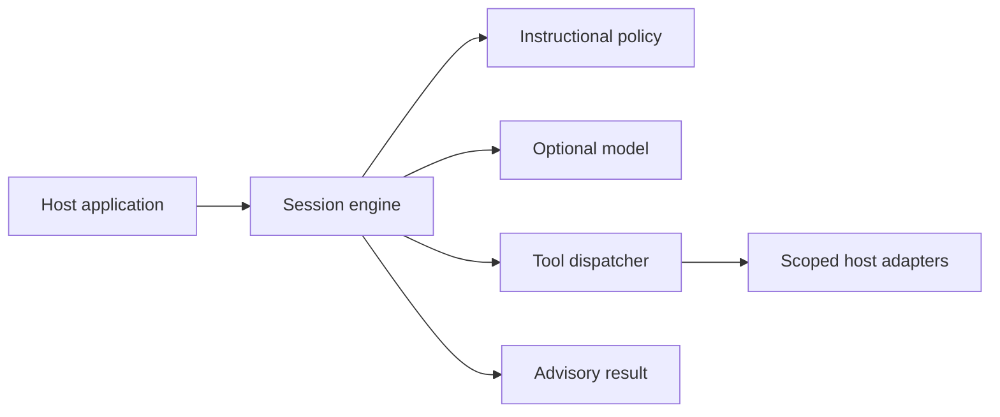
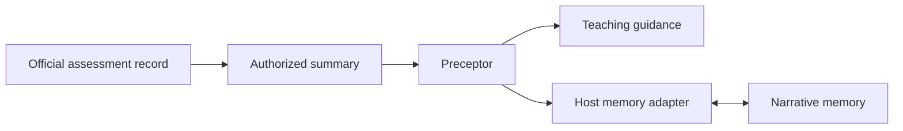

# Preceptor

Preceptor is an instructional engine for building tutors and learning applications. It helps decide when to explain a concept, ask a question, offer a hint or suggest practice based on the learner's request and the purpose of the session.

The instructional policy works without a language model. Applications can connect a model, lesson source and learner memory for contextual teaching. The host controls access to learner data and retains authority over assessment, grades and academic progress.

## Status

Preceptor is in development. The model-free instructional planner is implemented; model, lesson, memory and assessment-summary integrations are planned. The package is not yet available on npm.

## Intended features

- Deterministic teaching strategies with no model or network required for planning.
- Guided learning, ungraded practice, retrieval coaching and project defense preparation.
- Optional model-generated explanations and feedback grounded in authorized lesson material.
- Scoped tools with explicit permissions, resource limits and cancellation.
- Optional learner memory with provenance, revision checks and protection against stale writes.
- Read-only summaries of committed assessment decisions, including corrections and revocations.

## Architecture



The host supplies the session mode, authorized context, permissions and limits. The policy selects a teaching strategy without performing I/O. For generative assistance, the session engine calls the injected model and validates its tool requests before the dispatcher invokes a host adapter.

Effective tool permissions are restricted by the session mode, host grants, learner consent and installed operations. Lesson text, model responses and stored memory cannot grant additional permissions. The engine reports unavailable or partial results when a provider fails or a limit is reached.

### Instructional modes

| Mode                  | Purpose                                                    |
| --------------------- | ---------------------------------------------------------- |
| `guided_learning`     | Explanations, questions and hints while studying           |
| `ungraded_practice`   | Exercises and formative feedback                           |
| `retrieval_coaching`  | Recall and review of previously studied material           |
| `defense_preparation` | Rehearsal using authorized public criteria                 |
| `assessment_locked`   | Fixed public process guidance, without model or tool calls |

For example, a programming tutor can ask a learner to predict a function's result before explaining its execution. A mathematics tutor can ask the learner to justify a step in a proof. Both use the same instructional policy with different lesson sources.

### Memory and assessment



Narrative memory holds instructional observations and learner preferences. The host enforces scope, consent, provenance and revision checks. Learner edits take precedence over delayed model proposals, and deleted facts must not be restored by replay.

Official academic records remain separate. Preceptor can explain an authorized assessment summary, but cannot change grades, admit submissions or issue credentials. Review recommendations from an independent scheduler may inform instruction without granting academic credit.

## Integration

Preceptor is designed to run inside the consuming application with caller-provided adapters. It requires no particular curriculum, model provider, database or cloud service. The application owns authentication, storage, transcript handling, privacy rights and provider costs.

The planned package name is `@0xbuff/preceptor`. Installation instructions and executable examples will be added once the public API and package have been verified.

## Development

Requires Node.js 24 or later, pnpm 11.2.2 and TypeScript 5.9.3 for development.

```sh
git clone https://github.com/0xbuffdev/preceptor.git
cd preceptor
corepack enable
pnpm install --frozen-lockfile
pnpm check
```

The full check runs strict type checking, Biome, Vitest, the tsdown build and an independent offline ESM and TypeScript package check. The model-free planner is available in the local build. See [the policy guide](docs/policy.md).

See [contributing](CONTRIBUTING.md), [security](SECURITY.md) and [source and release status](docs/source-rights.md).

## License

[Apache-2.0](LICENSE). See [copyright and attribution](COPYRIGHT.md).
