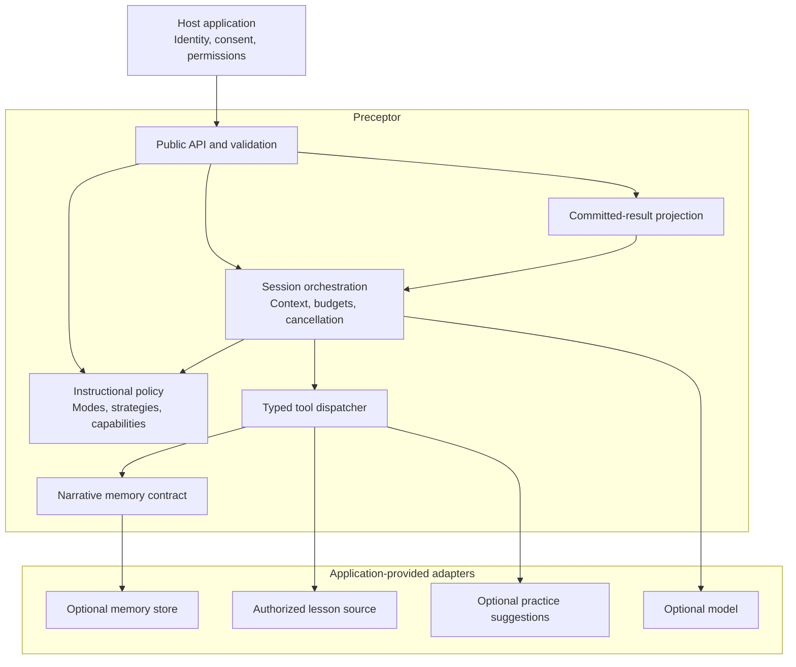
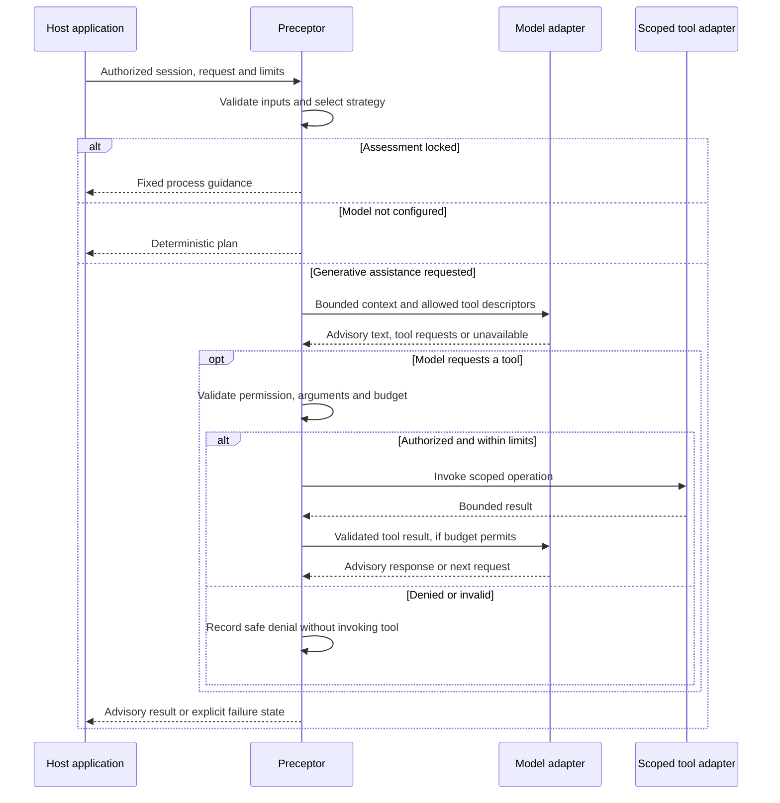
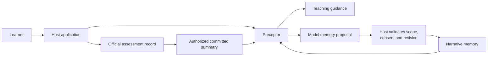

# Preceptor

Preceptor is a TypeScript library for building tutors and guided learning applications. It helps choose the next teaching step: explain a concept, ask a question, offer a hint or guide practice using lesson material.

The instructional policy is designed to work offline, without a language model. Applications can supply their own lesson sources, model and learner memory. No particular curriculum, model provider, database or hosted service is required.

Preceptor is in early development. The architecture below describes the intended behavior; the package is not yet available on npm.

## Use cases

- Guide a learner through a difficult concept without immediately giving away the answer.
- Generate ungraded practice questions, hints and reflection prompts using an optional model.
- Help learners recall previously studied material and rehearse explanations.
- Prepare learners for a project defense using authorized public criteria.
- Adapt instruction to learner-stated preferences and observed difficulties when memory is available.
- Explain feedback from an assessment that the application has already recorded.

A mathematics tutor could ask why a step in a proof is valid. A programming tutor could ask the learner to predict a function's return value before showing a worked example. Both can use the same instructional policy with different curricula and account systems.

The application remains responsible for deciding whether a learner has met an official requirement, passed an assessment or earned a credential.

## Architecture

Preceptor is a single library organized around a deterministic policy core and a session orchestrator. Applications connect external services through typed interfaces called ports, implementing them for their own lesson sources, models and memory stores.

The policy core selects a teaching strategy and calculates permitted capabilities from validated inputs, without network or storage access. Session orchestration manages context, optional model calls and resource limits. Before invoking an adapter, the dispatcher validates the arguments and checks whether the operation is authorized.

An application using the policy core alone receives a structured plan and fixed teaching prompts. Requests for generated feedback or model-based inspection are unavailable without a model.

### Instructional modes

The host chooses the authorized mode for a session. A learner can request a different approach, but neither the learner nor the model can relax the host's restrictions.

| Mode | Purpose |
| --- | --- |
| `guided_learning` | Explanations, questions and hints while studying |
| `ungraded_practice` | Exercises and feedback that do not award credit |
| `retrieval_coaching` | Recall and review of previously studied concepts |
| `defense_preparation` | Rehearsal using authorized public criteria |
| `assessment_locked` | Fixed public process guidance during restricted assessment |

The assessment-locked mode does not invoke a model or retrieve lesson, transcript or memory context.

### How a session works

The effective tool permissions are the intersection of the mode's capability ceiling, host grants, learner consent and installed operations. The model receives descriptors for permitted operations. Only the dispatcher invokes the adapters, after checking permissions on every request, regardless of what the model has read in lesson or memory content.

Every run has limits for context, output, model requests, tool attempts, retries and elapsed time. Failed or cancelled model calls return explicit failure states. The application and its adapters remain responsible for remote cancellation, provider quotas and any costs already incurred.

## Memory and academic records

Optional learner memory stores preferences, recurring difficulties and instructional observations. These facts inform the next teaching step and carry no academic credit.

When a model proposes a memory change, the host assigns provenance and checks consent, scope and revision before storing it. Learner edits take precedence over delayed model proposals. Deleted facts must not reappear through stale callbacks or replay. The host owns physical erasure, export, backups and retention policy.

Official assessment records belong to the application. Preceptor may receive a minimal summary after an authorized decision has been committed, including corrections or revocations. It has no operation to write a grade, modify a rubric, issue a credential or change enrollment.

The host can also supply advisory practice recommendations from an independent scheduler. They carry no academic credit.

## Integration

Preceptor runs as a library within the consuming application. The application authenticates its users, binds adapters to the authorized learner and decides what context the session may access. It can use a local or remote model, its own memory backend or no persistent memory at all.

The initial distribution target is a TypeScript ESM package for Node.js under the proposed name `@0xbuff/preceptor`. Installation instructions, public API examples and supported runtime versions will follow package verification. Browser and edge support are not yet established.

## Development

The source layout will separate public contracts, instructional policy, strategies, session orchestration, dispatch, ports, memory and committed-result summaries. Vitest and tsdown will be development dependencies for testing and building the ESM package with TypeScript declarations.

Development starts with the repository and its build and test tooling. The policy core comes next, followed by model and lesson orchestration, memory, committed-result summaries and independent package verification.

No model account or paid service will be required to develop or test the model-free core. Release and licensing decisions remain separate from implementation.
