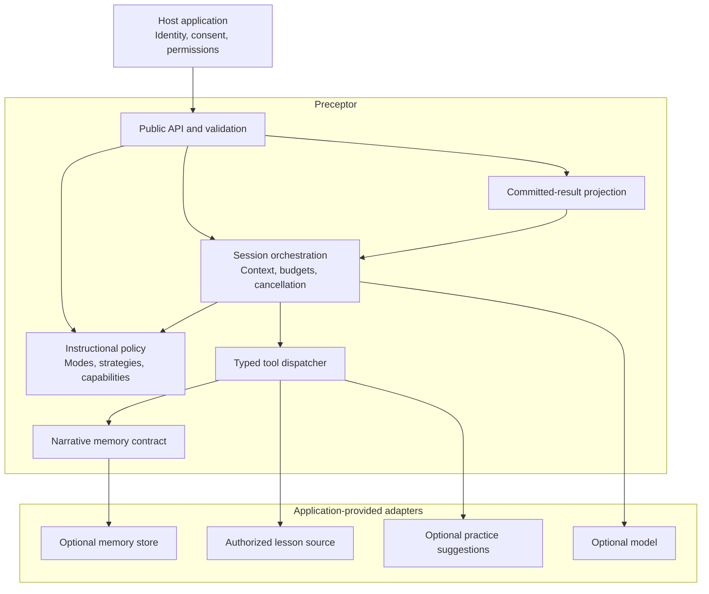
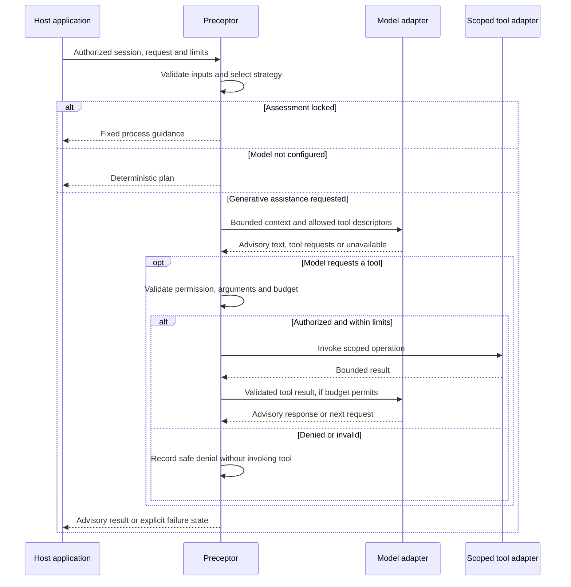
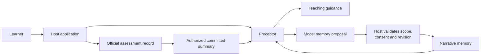

# Preceptor

Preceptor is a TypeScript library being built for guided learning. It helps an application decide what to teach next, when to ask a question, when to offer a hint and how to use lesson material to guide a learner.

The instructional policy works without a language model. Applications can supply their own model, lesson sources and learner memory when they need more contextual guidance. Preceptor does not require a particular curriculum, model provider, database or hosted service.

**Status:** Preceptor is in early development. This README describes the planned architecture. The package is not yet available on npm.

## What can you use it for?

- Guide a learner through a difficult concept without immediately giving away the answer.
- Generate ungraded practice questions, hints and reflection prompts using an optional model.
- Help learners recall previously studied material and rehearse explanations.
- Prepare learners for a project defense using authorized public criteria.
- Adapt instruction to learner-stated preferences and observed difficulties when memory is available.
- Explain feedback from an assessment that the application has already recorded.

For example, a mathematics application could ask a learner to explain why a step in a proof is valid. A programming tutor could ask what a function will return before showing a worked example. Both can use the same instructional policy without sharing a curriculum or account system.

Preceptor provides teaching guidance. The application decides whether a learner has met an official requirement, passed an assessment or earned a credential.

## Architecture

Preceptor is designed as a single library with a deterministic policy core, a session orchestrator and a small set of typed interfaces for external services. Those interfaces are called ports. An application implements a port to connect its own lesson source, model or memory store.

The policy core has no network or storage dependencies. It selects a teaching strategy from validated inputs and calculates which capabilities are permitted. The session orchestrator handles optional model calls, context and resource limits. The dispatcher validates and authorizes every requested tool operation before invoking an adapter.

An application can use the policy core alone. Without a model, Preceptor can still return a structured plan and fixed teaching prompts. It does not pretend to have generated feedback or inspected a learner's work.

### Instructional modes

The host chooses the authorized mode for a session. A learner can request a different approach, but neither the learner nor the model can relax the host's restrictions.

| Mode | Purpose |
| --- | --- |
| `guided_learning` | Explanations, questions and hints while studying |
| `ungraded_practice` | Exercises and feedback that do not award credit |
| `retrieval_coaching` | Recall and review of previously studied concepts |
| `defense_preparation` | Rehearsal using authorized public criteria |
| `assessment_locked` | Fixed public process guidance during restricted assessment |

The assessment-locked mode does not invoke a model or retrieve lesson, transcript or memory context.

### How a session works

The effective tool permissions are the intersection of the mode's capability ceiling, host grants, learner consent and installed operations. The model only receives descriptors for permitted operations; it cannot execute them itself. Preceptor checks permissions again at dispatch, including when a request originates from a model that has read untrusted lesson or memory content.

Every run has limits for context, output, model requests, tool attempts, retries and elapsed time. A failed or cancelled model call does not become a fabricated teaching answer. The application and its adapters remain responsible for remote cancellation, provider quotas and any costs already incurred.

## Memory and academic records

Learner memory is optional. It can retain a preference, a recurring difficulty or an instructional observation. These facts are useful for deciding what to ask next, but they do not establish mastery.

A model may propose a memory change; the host assigns its provenance and checks consent, scope and revision before storing it. Learner edits take precedence over delayed model proposals. Deleted facts must not reappear through stale callbacks or replay. The host owns physical erasure, export, backups and retention policy.

Official assessment records belong to the application. Preceptor may receive a minimal summary after an authorized decision has been committed, including corrections or revocations. It has no operation to write a grade, modify a rubric, issue a credential or change enrollment.

Review scheduling is also separate. A host can supply advisory practice recommendations from a scheduler, but those recommendations do not establish academic credit.

## Integration

Preceptor is intended to run inside the consuming application, not as a separate service. The application authenticates its users, binds adapters to the authorized learner and decides what context the session may access. It can use a local or remote model, its own memory backend or no persistent memory at all.

The initial distribution target is a TypeScript ESM package for Node.js under the proposed name `@0xbuff/preceptor`. Installation instructions, public API examples and runtime compatibility details will be added when the implementation and package have been verified. Browser and edge support are not yet established.

## Development

The planned source layout separates public contracts, instructional policy, strategies, session orchestration, dispatch, ports, memory and committed-result summaries. Vitest will run the test suite, and tsdown will build the ESM package and TypeScript declarations. Both will be development dependencies.

The first development milestone establishes the repository, build and test tooling. The deterministic policy core comes next, followed by model and lesson orchestration, memory, committed-result summaries and independent package verification.

No model account or paid service will be required to develop or test the model-free core. Release and licensing decisions remain separate from implementation.
